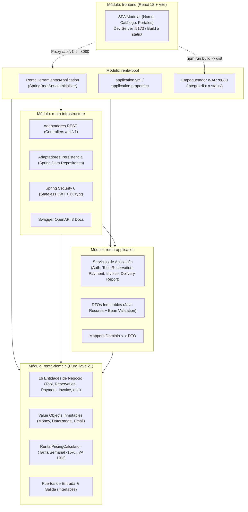
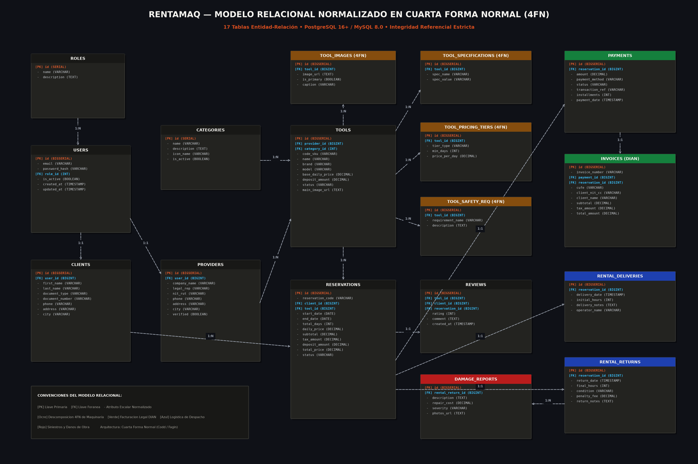

# RentaMaq — Plataforma de Renta de Herramientas y Equipos de Construcción

> Sistema empresarial de grado de producción para el arrendamiento, control logístico y liquidación tributaria de maquinaria y herramientas para obra civil en Colombia. Desarrollado con **Java 21 LTS**, **Spring Boot 3.4.2**, **Arquitectura Hexagonal (DDD)** y base de datos relacional compatible con **PostgreSQL 16+** y **MySQL 8.0+** normalizada en **Cuarta Forma Normal (4FN)**.

---

## 🛠️ Tecnologías Utilizadas

- **Lenguaje de Programación:** Java 21 LTS (cumple ampliamente con el requisito de Java 17+).
- **Framework Backend:** Spring Boot 3.4.2 (Spring Data JPA, Spring Security 6, Spring Web, Spring Boot Actuator).
- **Arquitectura de Software:** Arquitectura Hexagonal (Puertos y Adaptadores) orientada por el Dominio (DDD) en 4 módulos Maven independientes.
- **Bases de Datos Compatibles:**
  - **PostgreSQL 16 / 18:** Motor principal de producción con tipos avanzados y validación estricta.
  - **MySQL 8.0+:** Soporte dual con scripts DDL/DML dedicados ([sql/schema-mysql.sql](sql/schema-mysql.sql) y [sql/data-mysql.sql](sql/data-mysql.sql)).
- **Seguridad & Autenticación:** JSON Web Tokens (JWT) Stateless firmados con algoritmo HMAC-SHA256 y hashing de contraseñas con **BCrypt (costo 12)**.
- **Frontend SPA:** React 18, TypeScript, Tailwind CSS, Lucide Icons y Vite con diseño industrial sobrio de alta gama y consumo REST con Axios/Fetch interceptor.
- **Documentación de API:** Swagger UI / OpenAPI 3.0 (`springdoc-openapi`).
- **Pruebas Automatizadas:** JUnit 5, Mockito, AssertJ, Spring Boot Test y colección de pruebas en **Postman v2.1.0**.
- **Servidor Web & Despliegue:** Apache Tomcat 10.1+ (embebido o despliegue autónomo en contenedor `.war`).

---

## 🏗️ Arquitectura Hexagonal (Puertos y Adaptadores / DDD)

El backend está desacoplado rigurosamente en cuatro módulos Maven que aseguran la pureza del modelo del dominio y la independencia de frameworks externos:



### Principios de Aislamiento y Módulos
1. **`frontend`**: Interfaz de usuario SPA moderna desarrollada con React 18, Vite y Tailwind CSS. Cuenta con proxy de desarrollo a `:8080` y empaquetado optimizado directo a `renta-boot/src/main/resources/static/`.
2. **`renta-domain`**: 100% Java estándar. Cero dependencias de Spring, Jakarta EE o librerías externas. Contiene las reglas del negocio, validaciones de solapamiento de fechas y cálculo de tarifas con IVA (19%) y descuento semanal (15% para 7+ días).
3. **`renta-application`**: Orquesta los casos de uso, transacciones (`@Transactional`), DTOs inmutables (`records`) y validación de entrada (`jakarta.validation`).
4. **`renta-infrastructure`**: Implementa los adaptadores secundarios (persistencia en base de datos con 17 tablas en 4FN) y primarios (controladores REST documentados con OpenAPI 3, seguridad JWT y RFC 7807 `ProblemDetail`).
5. **`renta-boot`**: Ensambla los módulos backend, sirve los recursos estáticos del frontend, y empaqueta el artefacto `.war` ejecutable (autónomo o para servidor Tomcat externo).

---

## 🗄️ Modelo Relacional Normalizado en 4FN

El sistema cuenta con **17 tablas** rigurosamente normalizadas en **Cuarta Forma Normal (4FN)**, garantizando integridad referencial estricta y eliminando redundancias multivaluadas.

### Diagrama Relacional en Formato Imagen (Rúbrica Oficial)



### Descomposición 4FN en Herramientas
Para evitar anomalías de actualización y redundancia multivaluada, las propiedades independientes de cada herramienta se descompusieron en 4 tablas hijas:
- **`tool_images`**: Fotografías de inspección visual de la maquinaria.
- **`tool_specifications`**: Clave-valor normalizado (potencia, combustible, capacidad de balde, etc.).
- **`tool_pricing_tiers`**: Escalas de precio por duración (diaria base, semanal -15%, mensual).
- **`tool_safety_requirements`**: Protocolos de seguridad industrial y elementos de protección personal (EPP) obligatorios para operarios en obra.

### Scripts SQL Incluidos en el Repositorio
- **PostgreSQL 16+:**
  - DDL: [sql/schema.sql](sql/schema.sql)
  - DML (20+ registros semilla): [sql/data.sql](sql/data.sql)
- **MySQL 8.0+:**
  - DDL: [sql/schema-mysql.sql](sql/schema-mysql.sql)
  - DML (20+ registros semilla): [sql/data-mysql.sql](sql/data-mysql.sql)

---

## 👥 Cuentas de Acceso y Roles Predefinidos

La base de datos incluye datos semilla pre-cargados con hashes BCrypt reforzados (costo 12):

| Rol | Correo Electrónico | Contraseña Segura | Permisos y Capacidades |
| :--- | :--- | :--- | :--- |
| **👑 Administrador** | `admin@renta.com` | `Admin#Renta2026!SecOps` | Supervisión global, auditoría de usuarios/proveedores, catálogo nacional, métricas de recaudo e IVA consolidado. |
| **🏢 Proveedor** | `proveedor1@correo.com` | `Proveedor#Renta2026!Sec` | Gestión de maquinaria, aprobación/rechazo de solicitudes, despacho a obra y recepción con inspección técnica. |
| **👷 Cliente** | `cliente1@correo.com` | `Cliente#Renta2026!Sec` | Exploración de catálogo, cotización dinámica, reserva de equipos, pago en pasarela e impresión de factura electrónica. |

*(También existen clientes del 1 al 20: `cliente{1..20}@correo.com` con `Cliente#Renta2026!Sec` y proveedores del 1 al 20: `proveedor{1..20}@correo.com` con `Proveedor#Renta2026!Sec`)*.

---

## ⚙️ Ejemplo de Configuración `application.properties`

El archivo de configuración principal se encuentra en [renta-boot/src/main/resources/application.properties.example](renta-boot/src/main/resources/application.properties.example). Puedes configurarlo para PostgreSQL o MySQL según tu entorno local:

```properties
# ==============================================================================
# CONFIGURACIÓN DEL SERVIDOR Y APLICACIÓN
# ==============================================================================
server.port=8080
server.servlet.context-path=/
spring.application.name=renta-herramientas-api

# ==============================================================================
# OPCIÓN 1: CONEXIÓN A POSTGRESQL (Entorno Principal de Producción)
# ==============================================================================
spring.datasource.url=jdbc:postgresql://localhost:1129/renta_db
spring.datasource.username=postgres
spring.datasource.password=Renta2026
spring.datasource.driver-class-name=org.postgresql.Driver
spring.jpa.database-platform=org.hibernate.dialect.PostgreSQLDialect

# ==============================================================================
# OPCIÓN 2: CONEXIÓN A MYSQL 8.0+ (Soporte Alternativo)
# Descomentar las siguientes líneas si deseas ejecutar sobre MySQL:
# ==============================================================================
# spring.datasource.url=jdbc:mysql://localhost:3306/renta_db?useSSL=false&serverTimezone=UTC&allowPublicKeyRetrieval=true
# spring.datasource.username=root
# spring.datasource.password=Root2026!
# spring.datasource.driver-class-name=com.mysql.cj.jdbc.Driver
# spring.jpa.database-platform=org.hibernate.dialect.MySQLDialect

# ==============================================================================
# POOL DE CONEXIONES HIKARI-CP
# ==============================================================================
spring.datasource.hikari.maximum-pool-size=15
spring.datasource.hikari.minimum-idle=3
spring.datasource.hikari.idle-timeout=30000
spring.datasource.hikari.pool-name=RentaHikariPool
spring.datasource.hikari.connection-timeout=30000

# ==============================================================================
# JPA & HIBERNATE
# ==============================================================================
spring.jpa.hibernate.ddl-auto=validate
spring.jpa.show-sql=false
spring.jpa.open-in-view=false
spring.jpa.properties.hibernate.format_sql=true

# ==============================================================================
# SEGURIDAD Y JWT (HMAC-SHA256)
# ==============================================================================
jwt.secret=RentaHerramientasClaveSuperSeguraJWT2026ConMasDe256BitsParaHS256Firmado!
jwt.expiration-millis=43200000

# ==============================================================================
# CORS & SWAGGER OPENAPI
# ==============================================================================
app.cors.allowed-origins=http://localhost:5173,http://localhost:8080
springdoc.api-docs.path=/v3/api-docs
springdoc.swagger-ui.path=/swagger-ui.html
```

---

## 🚀 Instrucciones de Clonación, Compilación y Despliegue

### 1. Clonar el Repositorio
```bash
git clone https://github.com/TuUsuario/Proyecto_RentaHerramientas_SalasSebastian.git
cd Proyecto_RentaHerramientas_SalasSebastian
```

### 2. Inicializar la Base de Datos
* **Si usas PostgreSQL (Recomendado):**
  ```bash
  psql -U postgres -p 1129 -c "CREATE DATABASE renta_db;"
  psql -U postgres -p 1129 -d renta_db -f sql/schema.sql
  psql -U postgres -p 1129 -d renta_db -f sql/data.sql
  ```
* **Si usas MySQL:**
  ```bash
  mysql -u root -p -e "CREATE DATABASE renta_db;"
  mysql -u root -p renta_db < sql/schema-mysql.sql
  mysql -u root -p renta_db < sql/data-mysql.sql
  ```

### 3. Compilación y Empaquetado
```bash
# Compilar frontend y empaquetar WAR de Spring Boot
mvn clean package -DskipTests
```

### 4. Ejecución en Servidor Tomcat Embebido
```bash
java -jar renta-boot/target/renta-api.war
```

Acceder en el navegador:
- **Plataforma Web Completa:** [http://localhost:8080](http://localhost:8080)
- **Documentación Interactiva Swagger UI:** [http://localhost:8080/swagger-ui.html](http://localhost:8080/swagger-ui.html)
- **Especificación OpenAPI (JSON):** [http://localhost:8080/v3/api-docs](http://localhost:8080/v3/api-docs)

---

## 🧪 Guía de Pruebas Unitarias y de Integración

El proyecto incluye pruebas automatizadas exhaustivas que verifican la arquitectura y las reglas del negocio:

```bash
# Ejecutar todas las suites de prueba
mvn test
```

### Resumen de Suites de Prueba:
1. **`RentalPricingCalculatorTest` (Dominio):** Valida matemáticamente el cálculo de días, aplicación de descuento del 15% semanal e IVA del 19%.
2. **`FullRentalLifecycleIntegrationTest` (Integración):** Simula el ciclo completo: cotización -> creación de reserva -> aprobación de proveedor -> pago simulado -> emisión de factura DIAN con CUFE -> entrega en obra -> devolución con inspección técnica.
3. **`SecurityAuthorizationServiceTest` (Seguridad):** Verifica que un cliente no pueda ver reservas de otro cliente y que un proveedor solo pueda operar sus propias herramientas.
4. **`AdminControllerTest` (Infraestructura):** Verifica las restricciones de rol `ROLE_ADMIN` y activación/suspensión de cuentas.

---

## 📡 API RESTful: Endpoints y Ejemplos de Peticiones JSON

Todas las respuestas de error siguen el estándar **RFC 7807 (`ProblemDetail`)**.

### 1. Iniciar Sesión (`POST /api/v1/auth/login`)
* **Petición (JSON):**
  ```json
  {
    "email": "cliente1@correo.com",
    "password": "Cliente#Renta2026!Sec"
  }
  ```
* **Respuesta Exitosa (`200 OK`):**
  ```json
  {
    "token": "eyJhbGciOiJIUzI1NiIsInR5cCI6IkpXVCJ9...",
    "userId": 1,
    "email": "cliente1@correo.com",
    "role": "ROLE_CLIENTE",
    "displayName": "Carlos Gómez",
    "expiresIn": 43200000
  }
  ```

### 2. Cotizador Dinámico de Alquiler (`POST /api/v1/reservations/calculate-price`)
* **Petición (JSON):**
  ```json
  {
    "toolId": 1,
    "startDate": "2026-11-01",
    "endDate": "2026-11-08"
  }
  ```
* **Respuesta Exitosa (`200 OK`):**
  ```json
  {
    "toolId": 1,
    "toolName": "Excavadora Hidráulica 22 Ton",
    "startDate": "2026-11-01",
    "endDate": "2026-11-08",
    "totalDays": 7,
    "baseDailyPrice": 850000.00,
    "effectiveDailyPrice": 722500.00,
    "weeklyDiscountApplied": true,
    "subtotal": 5057500.00,
    "taxAmount": 960925.00,
    "depositAmount": 3000000.00,
    "totalPrice": 9018425.00
  }
  ```

### 3. Crear Reserva (`POST /api/v1/reservations`)
* **Encabezados:** `Authorization: Bearer <TOKEN_CLIENTE>`
* **Petición (JSON):**
  ```json
  {
    "toolId": 1,
    "clientId": 1,
    "startDate": "2026-11-10",
    "endDate": "2026-11-15",
    "notes": "Entrega en frente de obra Edificio Torres del Parque"
  }
  ```
* **Respuesta Exitosa (`201 Created`):**
  ```json
  {
    "id": 21,
    "reservationCode": "RES-2026-9F8C",
    "status": "PENDIENTE",
    "totalPrice": 6069000.00,
    "depositAmount": 3000000.00
  }
  ```

### 4. Procesar Pago y Facturación DIAN (`POST /api/v1/payments/process`)
* **Encabezados:** `Authorization: Bearer <TOKEN_CLIENTE>`
* **Petición (JSON):**
  ```json
  {
    "reservationId": 21,
    "paymentMethod": "TARJETA_CREDITO",
    "installmentCount": 3
  }
  ```
* **Respuesta Exitosa (`200 OK`):**
  ```json
  {
    "status": "COMPLETADO",
    "transactionId": "TXN-1792496073602-63FC",
    "cufe": "CUFE-SHA256-2026-DIAN-COLOMBIA-VAL-9F8C",
    "invoiceNumber": "FE-2026-0021"
  }
  ```

### 5. Dar de Baja / Eliminar Herramienta (`DELETE /api/v1/tools/{id}`)
* **Encabezados:** `Authorization: Bearer <TOKEN_ADMIN_O_PROVEEDOR>`
* **Respuesta Exitosa:** `204 No Content` (Cambia el estado de la herramienta a `RETIRADA`).

---

## 📮 Colección de Pruebas en Postman (GET, POST, PUT, DELETE)

El archivo de colección oficial se encuentra en [postman/renta_maquinaria_collection.json](postman/renta_maquinaria_collection.json).

### Características de la Colección:
- **Cobertura total de verbos HTTP:**
  - `POST`: Autenticación, creación de herramientas, cotización dinámica, reservas y pagos.
  - `GET`: Perfil `/auth/me`, catálogo de herramientas, detalle 4FN, reservas, facturas y reportes.
  - `PUT`: Actualización integral de herramientas y colecciones 4FN.
  - `PATCH`: Aprobación/cancelación de reservas, verificación de proveedores y suspensión de usuarios.
  - `DELETE`: Eliminación y baja lógica de herramientas del inventario (`DELETE /tools/{{test_tool_id}}`).
- **Scripts de prueba automáticos:** Captura y asignación automática de variables de entorno Postman (`token_admin`, `token_client`, `token_provider`, `test_reservation_id`, `test_tool_id`).

---

## 📄 Licencia y Autores
- Desarrollado como solución empresarial de grado de producción bajo principios DDD y Clean Code.
- © 2026 RentaMaq S.A.S. Todos los derechos reservados.
