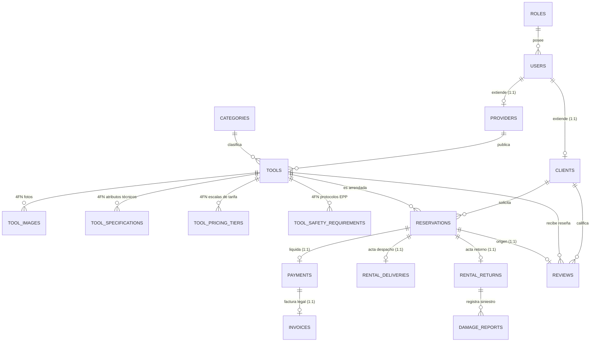

# RentaMaq - Plataforma de Renta de Maquinaria y Equipos de Construcción

> Sistema empresarial para el arrendamiento, control logístico y liquidación tributaria de maquinaria y herramientas para obra civil en Colombia. Desarrollado con **Java 21 LTS**, **Spring Boot 3.4.2**, **Arquitectura Hexagonal (DDD)** y base de datos relacional **PostgreSQL 18** normalizada en **Cuarta Forma Normal (4FN)**.

---

## 🏗️ Arquitectura Hexagonal (Puertos y Adaptadores / DDD)

El proyecto está desacoplado rigurosamente en cuatro módulos Maven que aseguran la pureza del modelo del dominio y la independencia de frameworks externos:


### Principios de Aislamiento y Módulos
1. **`frontend`**: Interfaz de usuario SPA desacoplada en la raíz del proyecto. Desarrollada con Vanilla JS moderno, Vite, CSS industrial y Tailwind CDN. Cuenta con proxy de desarrollo a `:8080` y empaquetado optimizado a `dist/`.
2. **`renta-domain`**: 100% Java estándar. Cero dependencias de Spring, Jakarta EE o librerías de persistencia. Contiene las reglas del negocio, validaciones de solapamiento de fechas y cálculo de tarifas con IVA (19%) y descuento semanal (15% para 7+ días).
3. **`renta-application`**: Orquesta los casos de uso, transacciones (`@Transactional`), DTOs inmutables (`records`) y validación de entrada (`jakarta.validation`).
4. **`renta-infrastructure`**: Implementa los puertos secundarios (persistencia en PostgreSQL con 17 tablas JPA en 4FN) y primarios (7 controladores REST documentados con OpenAPI 3, seguridad JWT y RFC 7807 `ProblemDetail`).
5. **`renta-boot`**: Ensambla los módulos backend, integra los recursos compilados de `frontend/dist` en `static/`, y empaqueta el artefacto `.war` ejecutable (autónomo o Tomcat 10+).

---

## 🗄️ Modelo Relacional Normalizado en 4FN (PostgreSQL 18)

El esquema implementado en [sql/schema.sql](sql/schema.sql) consta de **17 tablas** rigurosamente normalizadas en **Cuarta Forma Normal (4FN)**, eliminando toda dependencia multivaluada trivial:



### Descomposición 4FN en Herramientas
Para evitar anomalías de actualización y redundancia multivaluada, las propiedades independientes de cada herramienta se descompusieron en 4 tablas hijas:
- **`tool_images`**: Fotografías de inspección visual de la maquinaria.
- **`tool_specifications`**: Clave-valor normalizado (potencia, combustible, capacidad de balde, etc.).
- **`tool_pricing_tiers`**: Escalas de precio por duración (diaria base, semanal -15%, mensual).
- **`tool_safety_requirements`**: Protocolos de seguridad industrial y elementos de protección personal (EPP) obligatorios para operarios en obra.

---

## 👥 Cuentas de Acceso y Roles Predefinidos

La base de datos incluye datos semilla pre-cargados ([sql/data.sql](sql/data.sql)) con hashes BCrypt reforzados (costo 12 / 4096 iteraciones):

| Rol | Correo Electrónico | Contraseña Segura | Permisos y Capacidades |
| :--- | :--- | :--- | :--- |
| **👑 Administrador** | `admin@renta.com` | `Admin#Renta2026!SecOps` | Supervisión global, auditoría de reservas, catálogo nacional, métricas de recaudo e IVA consolidado. |
| **🏢 Proveedor** | `proveedor1@correo.com` | `Proveedor#Renta2026!Sec` | Gestión de maquinaria, aprobación/rechazo de solicitudes, despacho a obra y recepción con inspección técnica. |
| **👷 Cliente** | `cliente1@correo.com` | `Cliente#Renta2026!Sec` | Exploración de catálogo, cotización dinámica, reserva de equipos, pago en pasarela e impresión de factura electrónica. |

*(También existen clientes del 1 al 20: `cliente{1..20}@correo.com` con `Cliente#Renta2026!Sec` y proveedores del 1 al 20: `proveedor{1..20}@correo.com` con `Proveedor#Renta2026!Sec`)*.

> [!IMPORTANT]
> **Política de Seguridad de Contraseñas:**  
> Todas las cuentas del sistema requieren un mínimo de 8 caracteres, al menos una mayúscula, una minúscula, un número y un caracter especial (`@$!%*?&#^()_+-=`). Las contraseñas se almacenan mediante `BCryptPasswordEncoder(12)`.

---

## 🚀 Inicio Rápido en Entorno Local

### 1. Prerrequisitos
- **Java**: JDK 21 LTS instalado (`java -version`).
- **Maven**: 3.9+ instalado (`mvn -version`).
- **PostgreSQL**: Versión 18 (o 15+) en ejecución en el puerto `1129` (o configurado en `application.yml`).

### 2. Preparar Base de Datos
En pgAdmin o mediante `psql`:
```sql
CREATE DATABASE renta_db;
\c renta_db
\i sql/schema.sql
\i sql/data.sql
```

### 3. Compilación y Ejecución
```bash
# Compilar y empaquetar el proyecto
mvn clean package -DskipTests

# Ejecutar aplicación Spring Boot
java -jar renta-boot/target/renta-api.war
```

Acceder en el navegador:
- **Aplicación Web**: [http://localhost:8080](http://localhost:8080)
- **Documentación Swagger OpenAPI 3**: [http://localhost:8080/swagger-ui.html](http://localhost:8080/swagger-ui.html)
- **Especificación OpenAPI (JSON)**: [http://localhost:8080/v3/api-docs](http://localhost:8080/v3/api-docs)

---

## 📡 API RESTful (Endpoints Principales)

Todas las respuestas de error implementan el estándar **RFC 7807 (ProblemDetail)**:

### 1. Autenticación & Usuarios
- `POST /api/v1/auth/login`: Autenticación con JWT (Admin, Cliente, Proveedor).
- `POST /api/v1/auth/register-client`: Registro de cliente con documento (CC/NIT).
- `POST /api/v1/auth/register-provider`: Registro corporativo de proveedor con NIT/RUT.
- `GET /api/v1/auth/me`: Perfil del usuario autenticado.

### 2. Panel Administrativo (Sprint 1 - HU-03)
- `GET /api/v1/admin/users`: Listado de usuarios con estado activo/inactivo.
- `PATCH /api/v1/admin/users/{id}/status`: Suspender o reactivar usuario.
- `GET /api/v1/admin/providers`: Listado de empresas proveedoras.
- `PATCH /api/v1/admin/providers/{id}/verify`: Otorgar sello oficial de verificación.

### 3. Catálogo & Gestión 4FN (Sprint 1 - HU-01, HU-02)
- `GET /api/v1/tools`: Catálogo público con filtros combinados (texto, categoría, precio min/max).
- `GET /api/v1/tools/{id}`: Ficha técnica detallada con sus 4 tablas 4FN.
- `POST /api/v1/tools`: Registro de herramienta con fotos, especificaciones, tarifas y seguridad.
- `PUT /api/v1/tools/{id}`: Edición de herramienta y colecciones 4FN.
- `PATCH /api/v1/tools/{id}/retire`: Dar de baja equipo (pasa a `RETIRADA`).

### 4. Cotizador & Reservas
- `POST /api/v1/reservations/calculate-price`: Cotizador dinámico (días, descuento 15% semanal, IVA 19%).
- `POST /api/v1/reservations`: Creación de solicitud de reserva (estado `PENDIENTE`).
- `PATCH /api/v1/reservations/{id}/approve`: Aprobación de reserva (`APROBADA`).
- `PATCH /api/v1/reservations/{id}/cancel`: Cancelación formal con motivo registrado.

### 5. Pasarela de Pagos & Factura DIAN
- `POST /api/v1/payments/process`: Pasarela de pago simulada (tarjeta, PSE, transferencia).
- `GET /api/v1/invoices/reservation/{id}`: Consulta y emisión de factura electrónica con CUFE e IVA 19%.

### 6. Logística, Devoluciones y Averías (Sprint 2 - HU-04)
- `POST /api/v1/deliveries`: Acta de despacho a obra (transiciona a `EN_CURSO`).
- `POST /api/v1/returns`: Acta de devolución e inspección técnica (transiciona a `FINALIZADA`). Si se registra `DANADO` o fee > 0, crea el reporte en `damage_reports` y pasa la máquina a `MANTENIMIENTO`.
- `GET /api/v1/damages/return/{returnId}`: Consulta técnica del siniestro o avería.
- `GET /api/v1/logistics/settlement/{reservationId}`: Liquidación transparente de garantía (`DepositSettlement`).

### 7. Reseñas y Calificaciones
- `POST /api/v1/reviews`: Calificación (1 a 5 estrellas) y reseña de herramienta.
- `GET /api/v1/reviews/tool/{toolId}`: Historial de calificaciones y promedio.

### 8. Analítica Gerencial Dinámica (Sprint 2 - HU-05)
- `GET /api/v1/reports/admin`: Métricas en tiempo real, facturación mensual dinámica agrupada por periodo `YYYY-MM` en $O(N)$ y ranking Top 5 Clientes Frecuentes.
- `GET /api/v1/reports/provider/{id}`: Métricas de rendimiento e ingresos del proveedor.

---

## 📮 Colección de Pruebas Postman

El proyecto incluye una colección lista para importar en Postman v2.1.0:
- **Ruta del archivo**: [postman/renta_maquinaria_collection.json](postman/renta_maquinaria_collection.json)
- **Variables automáticas**: Configura automáticamente los tokens JWT (`token_admin`, `token_client`, `token_provider`) y los IDs dinámicos de reservas (`test_reservation_id`) y devoluciones (`test_return_id`) al ejecutar las solicitudes en secuencia.

---

## 📅 Roadmap de Implementación por Sprints

| Sprint | Historias | Alcance y Logros | Estado |
| :--- | :--- | :--- | :--- |
| **Sprint 1** | HU-01, HU-02, HU-03 | Modales para crear/editar herramientas con 4 tablas 4FN, botón "Dar de baja", gestión de usuarios (activar/suspender) y verificación de proveedores. | ✅ **100% Completado** |
| **Sprint 2** | HU-04, HU-05 | Registro de averías en `damage_reports`, pase automático a `MANTENIMIENTO`, analítica de ingresos mensuales dinámica en $O(N)$ y Top 5 Clientes Frecuentes. | ✅ **100% Completado** |
| **Sprint 3** | HU-06, HU-07 | Suite de tests unitarios con Mockito en `renta-application`, colección completa de Postman y documentación normalizada con diagrama ER de 17 tablas. | ✅ **100% Completado** |
| **Sprint 4** | HU-08 a HU-11 | Funciones Plus: Gráficas dinámicas Chart.js en dashboards, Checklist de EPP en acta de despacho, Código QR para CUFE y Campana In-App de notificaciones. | ⏳ *Siguiente Sprint* |

---

## 📄 Licencia y Autores
- Desarrollado como solución empresarial de grado de producción bajo principios DDD y Clean Code.
- © 2026 RentaMaq S.A.S. Todos los derechos reservados.

