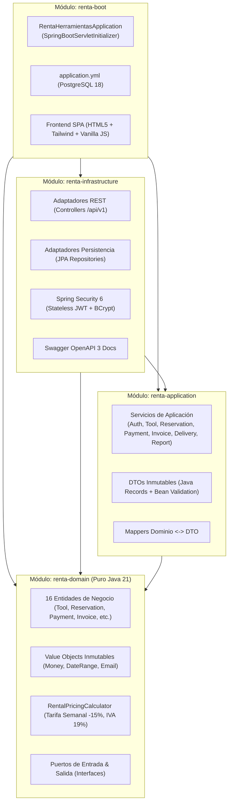
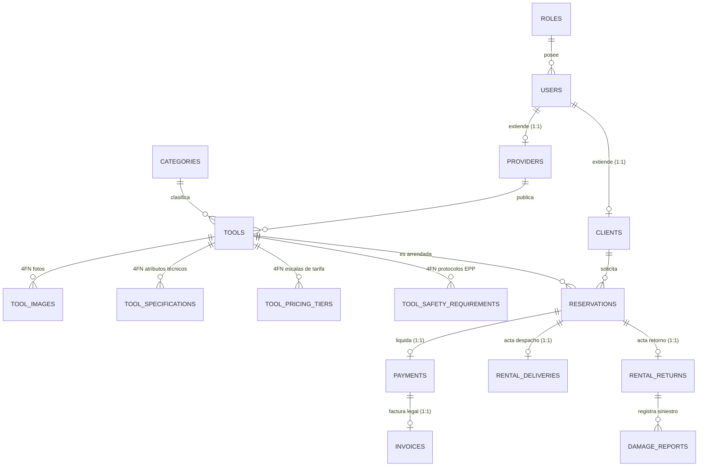

# RentaMaq - Plataforma de Renta de Maquinaria y Equipos de Construcción

> Sistema empresarial para el arrendamiento, control logístico y liquidación tributaria de maquinaria y herramientas para obra civil en Colombia. Desarrollado con **Java 21 LTS**, **Spring Boot 3.4.2**, **Arquitectura Hexagonal (DDD)** y base de datos relacional **PostgreSQL 18** normalizada en **Cuarta Forma Normal (4FN)**.

---

## 🏗️ Arquitectura Hexagonal (Puertos y Adaptadores / DDD)

El proyecto está desacoplado rigurosamente en cuatro módulos Maven que aseguran la pureza del modelo del dominio y la independencia de frameworks externos:



### Principios de Aislamiento
1. **`renta-domain`**: 100% Java estándar. Cero dependencias de Spring, Jakarta EE o librerías de persistencia. Contiene las reglas del negocio, validaciones de solapamiento de fechas y cálculo de tarifas con IVA (19%) y descuento semanal (15% para 7+ días).
2. **`renta-application`**: Orquesta los casos de uso, transacciones (`@Transactional`), DTOs inmutables (`records`) y validación de entrada (`jakarta.validation`).
3. **`renta-infrastructure`**: Implementa los puertos secundarios (persistencia en PostgreSQL con 16 entidades JPA en 4FN) y primarios (7 controladores REST documentados con OpenAPI 3, seguridad JWT y RFC 7807 `ProblemDetail`).
4. **`renta-boot`**: Ensambla los módulos, configura el contenedor embebido o empaquetado para servidor externo (`.war`), y sirve el frontend SPA interactivo.

---

## 🗄️ Modelo Relacional Normalizado en 4FN (PostgreSQL 18)

El esquema implementado en [`sql/schema.sql`](file:///c:/Users/USUARIO/OneDrive/Documents/proyecto_springboot/sql/schema.sql) consta de **16 tablas** rigurosamente normalizadas en **Cuarta Forma Normal (4FN)**, eliminando toda dependencia multivaluada trivial:



### Descomposición 4FN en Herramientas
Para evitar anomalías de actualización y redundancia multivaluada, las propiedades independientes de cada herramienta se descompusieron en 4 tablas hijas:
- **`tool_images`**: Fotografías de inspección visual de la maquinaria.
- **`tool_specifications`**: Clave-valor normalizado (potencia, combustible, capacidad de balde, etc.).
- **`tool_pricing_tiers`**: Escalas de precio por duración (diaria base, semanal -15%, mensual).
- **`tool_safety_requirements`**: Protocolos de seguridad industrial y elementos de protección personal (EPP) obligatorios para operarios en obra.

---

## 👥 Cuentas de Acceso y Roles Predefinidos

La base de datos incluye datos semilla pre-cargados ([`sql/data.sql`](file:///c:/Users/USUARIO/OneDrive/Documents/proyecto_springboot/sql/data.sql)) con hashes BCrypt válidos:

| Rol | Correo Electrónico | Contraseña | Permisos y Capacidades |
| :--- | :--- | :--- | :--- |
| **👑 Administrador** | `admin@renta.com` | `Admin123*` | Supervisión global, auditoría de reservas, catálogo nacional, métricas de recaudo e IVA consolidado. |
| **🏢 Proveedor** | `proveedor1@correo.com` | `Password123*` | Gestión de maquinaria, aprobación/rechazo de solicitudes, despacho a obra y recepción con inspección técnica. |
| **👷 Cliente** | `cliente1@correo.com` | `Password123*` | Exploración de catálogo, cotización dinámica, reserva de equipos, pago en pasarela e impresión de factura electrónica. |

*(También existen clientes del 1 al 20: `cliente{1..20}@correo.com` y proveedores del 1 al 20: `proveedor{1..20}@correo.com` con contraseña `Password123*`)*.

---

## 🚀 Inicio Rápido en Entorno Local

### 1. Prerrequisitos
- **Java**: JDK 21 LTS instalado (`java -version`).
- **Maven**: 3.9+ instalado (`mvn -version`).
- **PostgreSQL**: Versión 18 (o 15+) en ejecución en el puerto `1129` (o configurado en `application.yml`).

### 2. Preparar Base de Datos
En pgAdmin o mediante `psql`:
```sql
CREATE DATABASE renta_db;
\c renta_db
\i sql/schema.sql
\i sql/data.sql
```

### 3. Compilación y Ejecución
```bash
# Compilar y empaquetar el proyecto
mvn clean package -DskipTests

# Ejecutar aplicación Spring Boot
java -jar renta-boot/target/renta-api.war
```

Acceder en el navegador:
- **Aplicación Web**: [http://localhost:8080](http://localhost:8080)
- **Documentación Swagger OpenAPI 3**: [http://localhost:8080/swagger-ui.html](http://localhost:8080/swagger-ui.html)
- **Especificación OpenAPI (JSON)**: [http://localhost:8080/v3/api-docs](http://localhost:8080/v3/api-docs)

---

## 📡 API RESTful (Endpoints Principales)

Todas las respuestas de error implementan el estándar **RFC 7807 (ProblemDetail)**:

- `POST /api/v1/auth/login`: Autenticación y obtención de JWT.
- `POST /api/v1/auth/register-client`: Registro de cliente con documento (CC/NIT).
- `POST /api/v1/auth/register-provider`: Registro corporativo de proveedor con NIT/RUT.
- `GET /api/v1/tools`: Catálogo público con filtros por texto, categoría y rango de precios.
- `GET /api/v1/tools/{id}`: Ficha técnica detallada con relaciones 4FN.
- `POST /api/v1/reservations/calculate-price`: Cotizador dinámico (días, descuento 15%, IVA 19%).
- `POST /api/v1/reservations`: Creación de solicitud de reserva.
- `PATCH /api/v1/provider/reservations/{id}/approve`: Aprobación de reserva por proveedor.
- `POST /api/v1/payments/process`: Pasarela de pago simulada (tarjeta, PSE, transferencia).
- `GET /api/v1/invoices/reservation/{id}`: Consulta y generación de factura electrónica DIAN.
- `POST /api/v1/deliveries/start-rental`: Acta de despacho y entrega a pie de obra.
- `POST /api/v1/deliveries/finish-rental`: Acta de retorno, inspección técnica y reembolso de garantía.
- `GET /api/v1/admin/dashboard`: Métricas gerenciales consolidadas.

---

## 📄 Licencia y Autores
- Desarrollado como solución empresarial de grado de producción bajo principios DDD y Clean Code.
- © 2026 RentaMaq S.A.S. Todos los derechos reservados.
